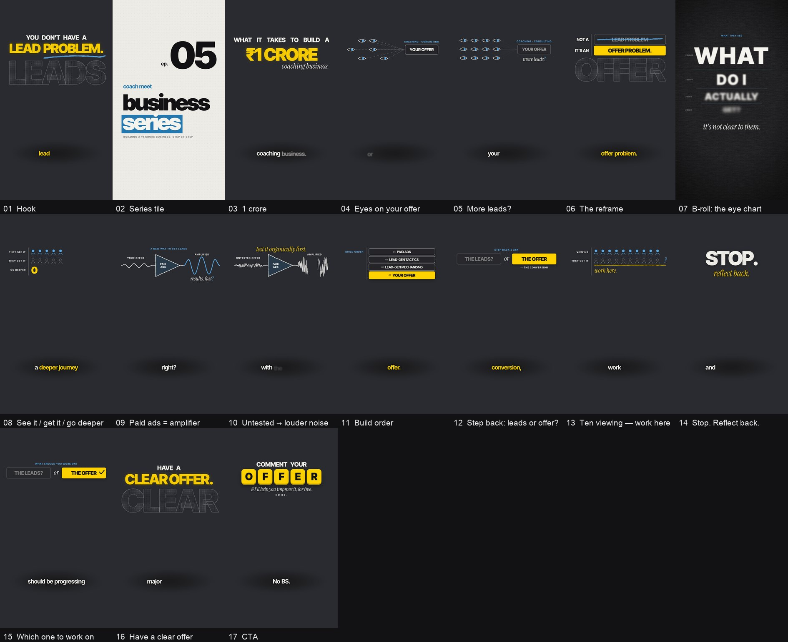

# origami-blue

A [Claude Code](https://claude.com/claude-code) skill that edits vertical talking-head reels (Instagram Reels,
Shorts, TikTok) in one premium, editorial style, built with [HyperFrames](https://hyperframes.heygen.com).



*The graphics of one finished episode, one frame per beat. In the real video the speaker sits in front of these:
the diagrams pass behind the head, and the headlines stay clear of it.*

**The look.** Blue builds the structure and yellow marks the one moment that matters. The type is Inter Tight with
Instrument Serif italic. Hand-drawn line-art diagrams sit *behind* the speaker (chroma key), and the textures
(line boil, dry brush, halftone, paper) are kept subtle. The footage is never shrunk or boxed, and captions sit
under the chin.

**The thinking.** Claude reads the transcript and finds the one belief the video flips. It then invents a
physical metaphor for each beat (a scale that tips, a slider stuck far from "what you're worth", dominoes that
fall, an eye chart going out of focus). Each element enters on the exact word it illustrates.

**The workflow.** Cards come first. Claude shows you each beat frozen on the real footage, and nothing long
renders until you approve. Then it builds the full edit and renders a draft plus a phone preview.

## What you need

- A Mac with Apple Silicon. It's tested on an 8 GB M2: cards take minutes, and a full draft takes about 1–1.5 h
  for a 2-minute reel.
- Claude Code.
- Node.js 18+ and ffmpeg (`brew install node ffmpeg`).
- Python 3 with numpy, pillow and scipy.
- About 10 GB of free disk per episode.
- Footage of one speaker in a fixed seat, filmed vertically (iPhone HDR is fine). For each new room or framing,
  you mark the chroma-key area once, and Claude walks you through it.

## Install

```bash
git clone https://github.com/nopefallacy/origami-blue.git ~/.claude/skills/origami-blue
cd ~/.claude/skills/origami-blue/scripts/node && npm ci
bash ~/.claude/skills/origami-blue/scripts/get_sfx.sh
python3 -m venv ~/.cache/ob-venv && ~/.cache/ob-venv/bin/pip install numpy pillow scipy
```

Restart Claude Code so it picks up the skill. To update later, run
`git -C ~/.claude/skills/origami-blue pull`.

## Use it

Put the raw clips in a dated folder (for example `my-videos/oct-12/`), open Claude Code in `my-videos/`, and say:

> Edit the videos in oct-12 in origami-blue. Show me the cards first.

1. **Cards.** You get an overview sheet and 2×2 boards with notes. Reply by card number ("card 7: make the
   headline shorter").
2. **Approve.** Say so, and Claude builds the full edit and renders a draft plus a preview under 30 MB for your
   phone.
3. **Revise.** Give feedback by timestamp, and only those seconds re-render.

Drafts stay draft quality until you ask for the final.

**Not part of the Coach Meet Business Series?** Tell Claude your series name, tile wording and call to action, or
say the video is a one-off. The craft stays the same, and your own branding replaces the series identity.

## What's inside

| | |
|---|---|
| `SKILL.md` | The quality bar and the phase-by-phase workflow Claude follows |
| `references/style-system.md` | Palette, type, layout and safe zones, components, textures, motion, camera, captions, SFX |
| `references/metaphor-framework.md` | How to invent the visual for each beat, series vs one-off, callbacks, rhythm, a metaphor bank |
| `references/workflow.md` | Exact commands and file formats |
| `references/render-pipeline.md` | What renders reliably on an 8 GB Mac, and what doesn't |
| `references/feedback-log.md` | Every correction that shaped the style, and why |
| `examples/` | Four finished episodes (compositions, card specs, card sheets, final frames) and one plan-only example |
| `scripts/` | The pipeline: prep, cards, quick preview, chroma key, camera, render passes, composite, mix, revisions |
| `assets/` | Shared style and effects, plus the project template (fonts, textures, skeleton) |

## Sound effects

The repo doesn't include them, because the original set came from licensed libraries. `scripts/get_sfx.sh`
fetches stand-ins through HyperFrames. You can also drop your own short sounds into `assets/template/sfx/`:
`sfx_003.mp3` whoosh, `sfx_002.mp3` pop, `sfx_004.mp3` impact, `sfx_005.mp3` thud, `sfx_007.mp3` tick.

## Credits

- Built on [HyperFrames](https://hyperframes.heygen.com) (pinned to `hyperframes@0.8.134`) and
  [GSAP](https://gsap.com).
- Fonts: Inter Tight and Instrument Serif, under the SIL Open Font License (see `assets/template/fonts/OFL.txt`).
- The examples show only the graphics layer. The creator's footage isn't part of this repo.
